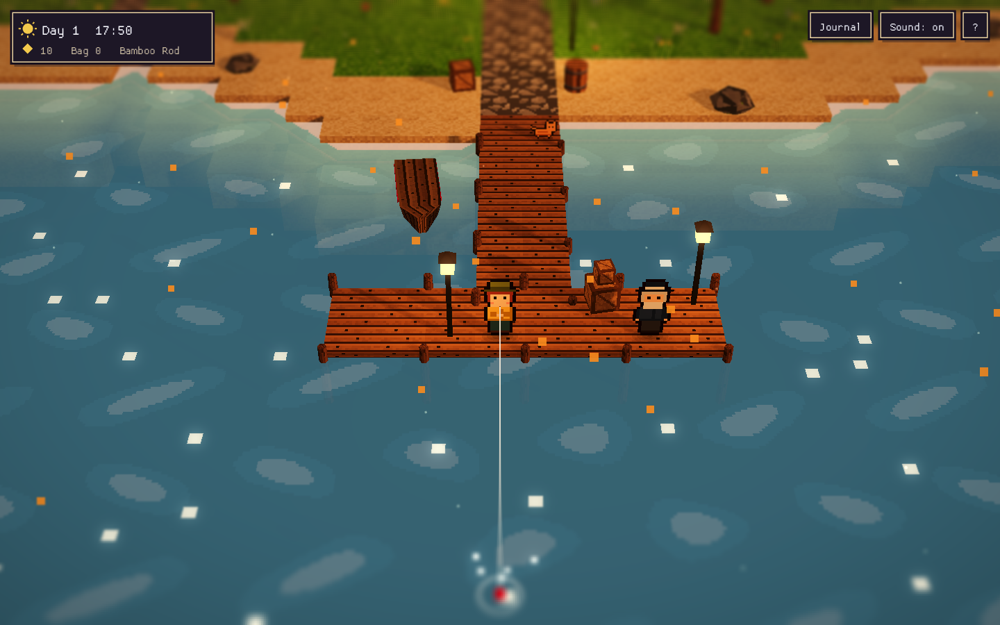

# Driftmoor Cove · Rust edition 🦀🎣

A cozy **HD-2D fishing game written in Rust** and compiled to **WebAssembly**: pixel-art characters in a lit 3D diorama with real-time shadows, tilt-shift blur, bloom and a full day/night cycle.

**▶ Play: https://ridermw.github.io/fishing-rs/**

This is a from-scratch Rust rewrite of the JavaScript/three.js original ([ridermw/fishing](https://github.com/ridermw/fishing)). Like the original, it ships **no image or audio files**. Every texture, sprite, fish icon and sound effect is generated in code when the game starts.



## How to play

| Action | Keys |
|---|---|
| Walk / run | WASD or arrows / hold Shift |
| Cast | Face the water, **hold Space** to wind up, release to cast |
| Hook | Press Space as soon as the **!** appears |
| Reel | **Hold Space** while the fish is calm and let go when it **runs** so the line doesn't snap |
| Journal / sound / help | J / M / H |

Touch screens get a virtual stick and an **A** button.

- **14 species.** What bites depends on sea or pond, shallow or deep water, and the time of day (day, night, dawn/dusk).
- **Sell** your catch to Marla at the market, then **buy better rods** that handle more tension, reel faster and attract rarer fish.
- Old Tobin at the end of the pier gives tips. Progress saves automatically in your browser.

## How it's built

| Layer | Rust module | What it does |
|---|---|---|
| Pixel art | `src/pixel.rs` | Procedural textures (grass, voronoi cobbles, timber walls, roofs), character sprite sheets, fish icons and a 3×5 sign font, all as RGBA buffers |
| Geometry | `src/geo.rs` | Vertex format, primitive builders (boxes, cylinders, cones, flat-shaded icosahedra) and a gutter-padded texture atlas |
| World | `src/world.rs` | Map generation, shoreline distance field, and the whole static scene baked into **one** mesh with 32-bit indices |
| Renderer | `src/gfx.rs` | Raw [miniquad](https://github.com/not-fl3/miniquad) (WebGL2): shadow map → lit scene (sun + hemisphere + 9 lantern point lights, ACES tone mapping, fog) → animated water and waterfall shaders → particles → bloom → tilt-shift composite |
| Gameplay | `src/main.rs`, `src/fishing.rs` | Game loop, day/night, the fishing state machine and tension mini-game, NPCs, shop, particles and input |
| UI | `src/ui.rs` | HUD, prompts, meters, dialog, catch card, journal and touch controls via [macroquad](https://github.com/not-fl3/macroquad) |
| Audio | `src/audio.rs` | Sound synthesis in Rust: oscillators and band-passed noise rendered to in-memory WAV buffers, played through macroquad |
| Web | `web/`, `src/platform.rs` | A small miniquad JS plugin for `localStorage` saves, URL options and a status snapshot for automated play-tests |

### Notes from the port

- macroquad's batcher isn't built for a static 3D world, so the scene uses raw miniquad buffers and pipelines while macroquad handles the window, input, text and audio.
- miniquad ties the depth **test** to `depth_write`, so the blended passes keep it on and particles are sorted back-to-front.
- miniquad requests unsized `DEPTH_COMPONENT` textures, which WebGL2 rejects. `web/driftmoor.js` swaps in a sized `DEPTH_COMPONENT24` format.
- Newer Rust toolchains reject undefined wasm imports, so `.cargo/config.toml` passes `--allow-undefined` for the JS-provided functions.

## Build and run

```sh
rustup target add wasm32-unknown-unknown
./build.sh                      # outputs ./dist
python3 -m http.server -d dist  # then open http://localhost:8000
```

URL options are useful for screenshots and testing, for example `?hour=18&at=dock&start=1` (`at` = `dock`, `shop`, `pond` or `plaza`).

Every push to `main` builds and deploys the game through GitHub Actions (`.github/workflows/pages.yml`). The web build is the tested target. The crate also compiles natively with `cargo build`.

## Built with Copilot

The whole port was produced in one Microsoft Scout/Copilot session: reading the macroquad and miniquad sources to confirm APIs, writing the modules, building to WebAssembly, and play-testing in a real browser. Each fix (depth formats, depth-test state, render-target lifetimes) was verified with automated cast → hook → reel → sell → journal runs.
